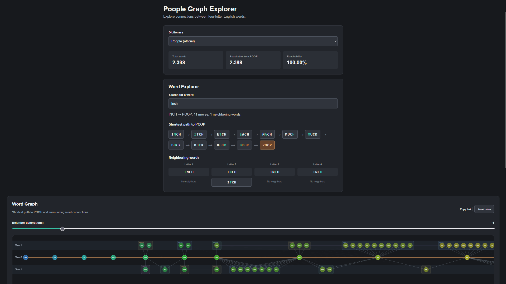

# Poople Graph Explorer

An interactive word-graph explorer inspired by [Poople](https://poople.io/).

Explore connections between four-letter English words and find the shortest path to **POOP** by changing one letter at a time.

## Explore the Website

**[Open Poople Graph Explorer](https://proyolo-ks1.github.io/poopleGraphExperimentation/)**

No installation required. Explore directly in your browser.

## Features

- Search for words and explore their neighbors.
- Find shortest paths to POOP using Breadth-First Search (BFS).
- Switch between different English dictionaries.
- Compare word counts and graph connectivity.

## Dictionaries

Uses word lists from [Poople](https://poople.io/), [DWYL English Words](https://github.com/dwyl/english-words), and [SCOWL/ESDB](https://wordlist.aspell.net/).

## Run Locally

To run the project locally, open `index.html` using a local HTTP server, such as VS Code Live Server.

## License

Original project code is licensed under the [MIT License](LICENSE). Third-party word lists retain their respective rights and licensing terms.

This is an independent project and is not affiliated with Poople.